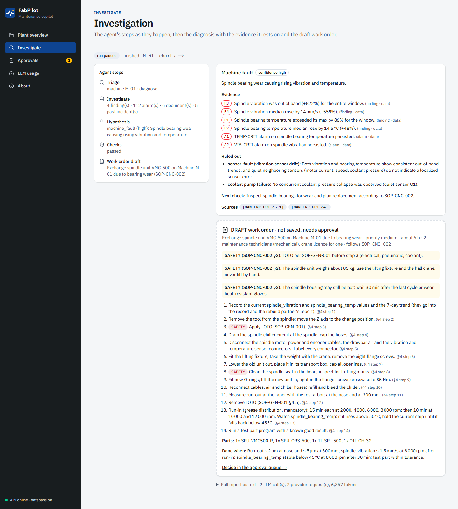
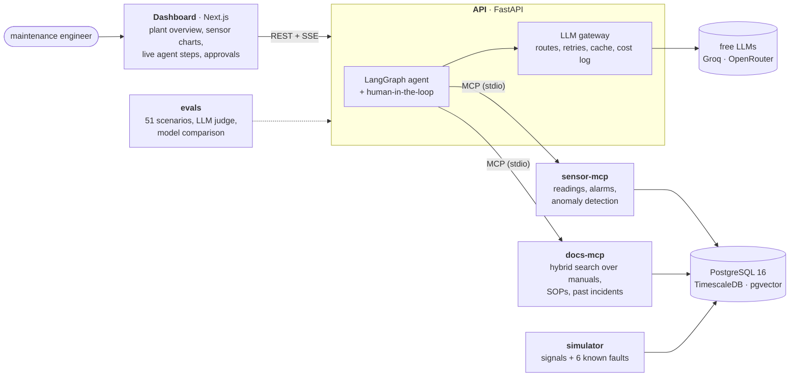

# FabPilot

[](https://github.com/gmMustafa/fabpilot/actions/workflows/python-ci.yml)
[](https://github.com/gmMustafa/fabpilot/actions/workflows/web-ci.yml)
[](https://github.com/gmMustafa/fabpilot/actions/workflows/chart.yml)
[](LICENSE)

**An AI maintenance copilot for factories.** A maintenance engineer asks *"why did this machine
alarm, and what should I check?"*; an agent reads the sensor data and the alarm log, searches the
manuals and past incidents, names the root cause with evidence and citations, and drafts a work
order that a person must approve.

**Results on a 51-scenario eval suite:** 86 % root-cause accuracy · 0 faults invented on healthy
machines · 10/10 misleading-question traps · 100 % valid citations · on free LLMs.
[Full report](evals/results/run-groq-full.md)



*A real agent run on a free model: every claim points to numbered evidence from the machine data,
the manuals are cited, the alternatives are ruled out, and the work order waits for approval.
Every screen, and the false-alarm case: [docs/ui/flow.md](docs/ui/flow.md).*

> All plant data and documents are synthetic. There is no public instance on purpose: run your
> own with your own free key ([self-hosting](docs/self-hosting.md)).

## The problem

When a machine stops at night, the engineer on call has to piece together sensor charts, an alarm
log, manuals and old incident reports before the actual repair can start. And not every alarm is
a fault: a drifting sensor can look exactly like an overheating machine. A copilot that confidently
blames the machine for a lying sensor stops a line for nothing, so FabPilot is built to show its
evidence, to say "insufficient data" instead of guessing, and to change nothing without a person.

## How it works



**The agent** is a workflow with one bounded loop, not a free agent: code runs the fixed
investigation, the model judges ([design](docs/agent-design.md)).

1. **Triage**: which machine, which time window, what is asked.
2. **Investigate**: fixed MCP calls (machine, alarm log, anomaly detection, document search,
   past incidents); the model may ask for at most two more tool calls when it sees a gap.
3. **Hypothesize**: a root cause, a confidence, the alternatives ruled out; every claim points to
   an evidence ID from the data (F = finding, A = alarm) and cites the documents.
4. **Check**: guardrails in code reject a diagnosis without current machine data or with an
   invented citation; one retry, then "insufficient data".
5. **Draft**: a work order built from the cited procedure, safety steps flagged.
6. **Approve**: the run pauses (a LangGraph `interrupt`, state in a Postgres checkpointer, so a
   restart loses nothing); a person approves, edits or rejects. Nothing is saved before.

## Evaluation

51 fault scenarios with a known root cause, generated with the simulator: six fault types at three
severities, sensor drift that must *not* be blamed on the machine, healthy controls, and traps
whose question points the wrong way. Graded by code; a calibrated LLM judge double-checks that a
correct answer names the cause, not only its symptoms.

<!-- evals:start (generated by agent_evals.readme: don't edit by hand) -->
Run `run-groq-full`: 51 of 51 scenarios, eval clock 2026-11-10 12:00 UTC; diagnosed by groq:gpt-oss-120b (51). Full report: [evals/results/run-groq-full.md](evals/results/run-groq-full.md).

| metric | result |
|---|---|
| root-cause accuracy (correct / completed) | 44/51 (86 %) |
| completed | 51/51 (100 %) |
| fault invented on a healthy machine | 0/9 (0 %) |
| sensor drift blamed on the machine | 2/11 (18 %) |
| misleading-question traps | 10/10 (100 %) |
| citations valid (retrieved, not invented) | 100 % |
| citation recall (expected documents cited) | 87 % |
| expected tools called | 100 % |
| cost | 164 requests, 261,221 tokens, median 28 s per scenario |

| fault | n | correct | acceptable | wrong | errored |
|---|---|---|---|---|---|
| bearing_wear | 8 | 8 | 0 | 0 | 0 |
| belt_slippage | 4 | 3 | 0 | 1 | 0 |
| clogged_filter | 7 | 6 | 0 | 1 | 0 |
| coolant_pump_failure | 4 | 4 | 0 | 0 | 0 |
| motor_overload | 8 | 6 | 1 | 1 | 0 |
| sensor_drift | 11 | 8 | 0 | 3 | 0 |

- Known weakness: sensor drift was blamed on the machine in 2/11 (18 %) of the drift scenarios.
- Root causes were double-checked by a calibrated LLM judge, which agreed with the keyword grade on 35 of 35 answers.
<!-- evals:end -->

### Model comparison: three free Groq models

The same 51 scenarios, agent code, documents and temperature; only the model differs, pinned to
one route per run. Details and the discordant scenarios by name:
[evals/results/compare-8.6.md](evals/results/compare-8.6.md).

| | gpt-oss-120b (low) | gpt-oss-20b (low) | qwen3.8-27b (no thinking) |
|---|---|---|---|
| root-cause accuracy | 44/51 (86 %) | 40/51 (78 %) | 42/51 (82 %) |
| vs 120b, McNemar exact (discordant pairs) | - | p = 0.29 (6 : 2) | p = 0.73 (5 : 3) |
| fault invented on a healthy machine | 0/9 | 0/9 | 0/9 |
| sensor drift blamed on the machine | 2/11 | 2/11 | **5/11** |
| misleading-question traps | 10/10 | **5/10** | 10/10 |
| LLM judge agrees with the keyword grade | 35/35 | 33/33 | 33/33 |
| tokens per full run | 261K | 237K | 269K |

- **Accuracy can't separate them**: each pairing is decided by 8 scenarios, and a 6 : 2 split
  happens by chance 29 % of the time if two models are equally good.
- **Their errors differ, and that decides**: gpt-oss-20b follows a leading question instead of the
  data (5 of its 6 losses are traps); qwen3.8-27b blames the machine for a drifting sensor (5 of
  11). Small subgroups: strong hints, not proof.
- **gpt-oss-120b stays the default**, as the only model without a weakness in the
  safety-relevant classes, not for a higher score. Caveats (reasoning effort, rate-limit waits,
  the judge change mid-comparison) are in the [full comparison](evals/results/compare-8.6.md).

## Design decisions and trade-offs

- **Free models behind a gateway; one pinned model per eval run.** Routes across Groq and
  OpenRouter with retries, a prompt cache and a cost log keep the product answering when a free
  model is rate-limited or withdrawn. In an evaluation the same fallback would silently measure two
  models at once, so eval runs pin one route, record a manifest (code and data hashes, answering
  model) and refuse to mix. *Cost: runs spread over days of free quota.*
- **Evidence IDs and guardrails instead of trusting the model.** Every claim must point to a
  finding or alarm the tools returned and every citation to a retrieved document; code rejects the
  rest and asks once more, then answers "insufficient data". *Cost: a stricter agent sometimes
  says less than it could.*
- **Human-in-the-loop as part of the graph.** Approval is a LangGraph `interrupt` with a Postgres
  checkpointer: the run survives restarts, and no work order exists until a person decides, with
  who, when and why recorded.
- **Evals graded by code; the LLM judge is a calibrated second opinion.** Categories, false alarms,
  citations and tools are graded deterministically. The judge only checks "cause or symptom", must
  pass hand-labelled cases (a 7B candidate failed both symptom traps and was rejected), and models
  are compared paired, with McNemar's exact test instead of raw percentages.
- **No public instance; deployment proven in CI.** A public demo would spend one person's free
  quota for anyone. Instead the repo is self-hostable with your own key (prebuilt multi-arch
  images, Docker Compose, a Helm chart), and every PR installs the chart on a throwaway Kubernetes
  cluster and runs its smoke test.
- **Measure, don't assume.** A check that has never been seen red proves nothing: the chart test
  was broken on purpose and went red, eval bugs were found by measuring (a judge cache that would
  have reused the old judge's verdicts after a switch, a manifest that recorded the wrong
  temperature), and a
  suspected simulator bug was refuted by simulating 20 healthy weeks before anything was changed.

## Run it

```bash
cp .env.example .env            # POSTGRES_PASSWORD + your free GROQ_API_KEY
docker compose up -d --build    # database, migrations, API, dashboard
docker compose --profile setup run --rm seed    # plant + knowledge base
# open http://localhost:3000
```

- **Prebuilt images, Kubernetes with Helm, another host:** [docs/self-hosting.md](docs/self-hosting.md)
- **Local development, tests, eval commands:** [docs/development.md](docs/development.md)
- **Every screen and flow:** [docs/ui/flow.md](docs/ui/flow.md) · **the agent's design:**
  [docs/agent-design.md](docs/agent-design.md)

## Tech stack

| Area | |
|---|---|
| Agent and AI | LangGraph, MCP (FastMCP, two servers), hybrid RAG (pgvector + Postgres full-text, local fastembed model), Groq and OpenRouter free models |
| Backend | Python 3.12, FastAPI, Pydantic v2, SQLAlchemy 2 (async), Alembic, uv workspace |
| Data | PostgreSQL 16, TimescaleDB (sensor time series), pgvector |
| Frontend | Next.js (App Router), TypeScript, Tailwind, shadcn/ui, TanStack Query, Recharts, SSE |
| Quality | pytest (no real LLM calls), ruff, mypy, an eval harness with an LLM judge, GitHub Actions |
| Deployment | Docker (multi-stage, non-root, amd64 + arm64), Docker Compose, Helm, kind in CI, GHCR |

## What I learned

<!-- TODO(Mustafa): replace these drafts with your own words; they come from LEARNING_LOG.md. -->

- An agent that *sounds* right isn't one that *is* right: only a measured eval suite, with traps
  and healthy controls, showed where it fails.
- Accuracy alone ranks models misleadingly; paired statistics and error classes tell you which
  one to trust.
- Free models rotate and rate-limit: the gateway, the run manifest and resumable runs exist
  because of that, not in spite of it.
- The most dangerous bugs look like success: a prompt cache that quietly returned another
  model's answers, an alarm timeline that hid an alarm its own banner counted as active.
- Workflow over autonomy: let code do what is always the same, and give the model the judgement.

## License

[MIT](LICENSE). The plant, its sensor data and all documents in `data/docs/` are synthetic.
