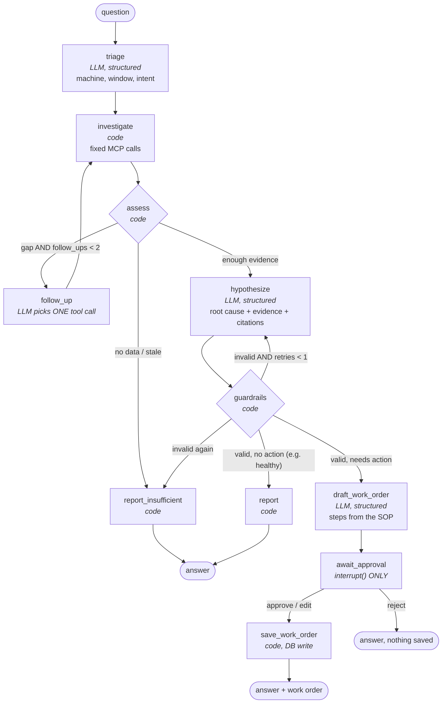

# FabPilot incident agent — design (5.1)

> **Before reading:** sketch your own graph first (the 5.1 TODO): nodes, order, where the human
> approves, where it may loop. Then compare.

Checked against the current libraries (2026-11-14): `langgraph` 1.2.22,
`langgraph-checkpoint-postgres` 3.2.1 (`AsyncPostgresSaver`, psycopg 3), `interrupt()` /
`Command(resume=...)` from `langgraph.types`. To re-check before 5.2: whether
`langchain-mcp-adapters` 0.3.2 supports our `mcp` 2.x (its page declares no dependency).

## 1. The central decision: a workflow with one bounded loop, not a free agent

The textbook agent is a loop: *the model picks a tool → we run it → repeat until the model stops*.
We don't build that, for three measured reasons:

- **Weak models.** Our LLMs are free OpenRouter models. Phase 4 showed that even a strong model
  misreads tool results without help; a weaker one in a free loop repeats calls, forgets steps and
  invents conclusions.
- **A budget of ~50 requests per day.** A free loop spends 10-20 requests per question. A workflow
  spends 3-4, so ~12 investigations a day fit.
- **The first steps are always the same.** Every investigation needs the machine and its sensors,
  the alarms, the anomaly report and the matching documents. Code can make those calls, without
  the model choosing.

So: **code runs the fixed investigation, the model judges.** One bounded loop lets the model ask
for *one* more tool call when it sees a gap. That's the "workflow vs. agent" distinction: use
autonomy only where the path can't be known in advance.

## 2. The graph

**LLM requests per run:** triage 1 + hypothesize 1 (+1 retry) + draft 1 (+0-2 follow-ups) =
**3 normally, 6 at most**. The prompt cache (2.3) makes a repeated question free.

## 3. State

One typed object (a `TypedDict` or a pydantic model) flows through the graph. Each node writes
ONLY its own fields, so every step is traceable and the checkpointer saves a complete record.

| Field | Written by | Meaning |
|---|---|---|
| `question` | caller | The engineer's question, verbatim |
| `incident_id` | caller | Optional: an incident row this run belongs to |
| `machine`, `window`, `intent` | triage | e.g. `M-08`, `[start, end)`, `diagnose` / `status` / `history` / `procedure` |
| `data_ends_at`, `data_age` | investigate | From `last_reading_at` (4.4): the freshness every later step must respect |
| `evidence` | investigate | Tool results: machine detail, alarm log (with `truncated`), anomaly report (findings, quiet sensors, checks not possible), document hits, incident list |
| `follow_ups` | follow_up | The extra tool calls the model asked for (max 2) |
| `hypothesis` | hypothesize | `root_cause`, `confidence`, `evidence_refs`, `citations`, `alternatives_ruled_out`, `insufficient_data` |
| `guard_errors`, `retries` | guardrails | Why a hypothesis was rejected, so the retry prompt can say it |
| `work_order` | draft_work_order | Actions (steps from the SOP), parts, priority, `sop_ref` |
| `decision` | await_approval (resume value) | `approve` / `edit` (with edits) / `reject`, `approved_by` |
| `llm_requests` | every LLM node | The budget guard counts here (5.4) |

## 4. Nodes

| Node | Kind | Input → output | Notes |
|---|---|---|---|
| `triage` | LLM, structured | question → machine, window, intent | The machine code is extracted with a regex FIRST (`M-\d\d`); the LLM is only asked when that fails. The default window is anchored to `data_ends_at`, not to now (F2) |
| `investigate` | code | machine, window → evidence | Always the same calls in parallel: `get_machine`, `get_alarm_log` (`limit=200`), `detect_anomalies`. Then documents chosen by the findings: `search_docs` with alarm codes and sensor names, and `list_incident_reports(machine=...)` |
| `assess` | code | evidence → next edge | Deterministic: data age vs. window, `truncated`, empty results, findings without matching documents |
| `follow_up` | LLM | evidence + the gap → ONE tool call | Chooses from the 9 MCP tools; arguments are validated against the tool's schema before calling |
| `hypothesize` | LLM, structured | evidence → hypothesis | Must cite evidence by id (`finding #2`, `[MAN-CMP-001 §5.2]`); may say `insufficient_data` |
| `guardrails` | code | hypothesis + evidence → valid / errors | Every citation must be among the RETRIEVED documents; every evidence ref must exist; a "the machine is fine NOW" claim needs fresh data; a sensor-fault claim needs `isolated` or a reference check in the work order |
| `draft_work_order` | LLM, structured | hypothesis + the cited SOP (read with `get_document`, F11) → work order | Steps come from the SOP text, not from model memory |
| `await_approval` | `interrupt()` only | work order → decision | Contains NOTHING else: on resume LangGraph re-runs the node from its start, so an LLM call or a DB write here would run twice |
| `save_work_order` | code | work order + decision → DB row | The only write in the whole graph, after approval |
| `report`, `report_insufficient` | code | state → answer | Assemble the answer; insufficient data says WHAT is missing (from `coverage_note`) |

## 5. Code vs. LLM: who decides what

Every decision taken away from the model is one it can't get wrong, and one request less.

| Decision | Made by | Why |
|---|---|---|
| Which machine | regex, LLM only as fallback | "M-08" is a pattern, not a judgement |
| Which window | code (anchored to `data_ends_at`) | F2 was the biggest Phase 4 failure |
| First tool calls | code | Always the same; a weak model would skip or misorder them |
| Is the data too old to say anything about NOW | code | Arithmetic on timestamps; models got it wrong (F18) |
| Is a citation real | code | The set of retrieved documents is known exactly |
| Which extra tool when evidence is missing | LLM, bounded to 2 | Can't be known in advance |
| What the evidence means (root cause) | LLM | The actual judgement |
| Which SOP steps fit | LLM, from the SOP text | Needs reading, but the text is given |
| Whether to save | HUMAN | The brief: nothing is saved without approval |

## 6. Persistence and human-in-the-loop

- **Checkpointer:** `AsyncPostgresSaver` (psycopg 3) in our Postgres. LangGraph saves the state
  after every node under a `thread_id` (one per investigation). A run survives an API restart and
  can wait for approval for hours. Own connections need `autocommit=True` and `row_factory=dict_row`.
  Its tables come from `setup()`, not from our Alembic migrations: keep them in their own schema and
  document that.
- **Interrupt:** `await_approval` calls `interrupt(work_order_payload)`; the run pauses and the API
  (6.2) shows the draft. The engineer answers with `Command(resume={"action": "approve" | "edit" |
  "reject", ...})` on the same `thread_id`; the resume value becomes `interrupt()`'s return value.
- **Approval is recorded:** `approved_by` plus the decision go into `work_orders` (the
  `approval_recorded` CHECK from 1.1 already enforces that an approved order names its approver).

## 7. Limits (5.4)

- Max 2 follow-ups, 1 hypothesis retry, so at most 6 LLM requests per run; a hard counter in the
  state stops the run with `report_insufficient` when a budget is exceeded.
- Every LLM call goes through OUR gateway (2.1-2.3: fallback models, retries, call log, cache), not
  directly through `langchain-openai`: otherwise the agent's requests would bypass the fallback list,
  the cost log and the cache. (The brief names `ChatOpenAI`; this is a deliberate deviation, to
  discuss in 5.2.)
- The agent never reads the `sim` schema: it only talks to the two MCP servers.

## 8. What this design deliberately does not do

- No free multi-step tool loop (section 1).
- No multi-agent setup: one graph, one state; nothing here needs agents talking to each other.
- No streaming in 5.x; that's the API's job in 6.1 (LangGraph can stream node updates).
