# FabPilot UI: screens and flows

What a maintenance engineer sees, in the order they would use it: a fault appears, the agent
diagnoses it with evidence, a person approves the work order. Then the counter-case every
diagnosis tool must survive: a **false alarm**, where the right answer is "the machine is fine,
the sensor is lying".

All screenshots are from the production build of the dashboard against the real API and
database, with a real agent run on a free Groq model (`openai/gpt-oss-120b`). The plant and its
documents are synthetic. To regenerate them after a UI change: [`capture.ps1`](capture.ps1).

| # | Screen | Route | Shows |
|---|---|---|---|
| 1 | [Plant overview](#1-a-healthy-plant) | `/` | every machine, live status, active alarms |
| 2 | [Plant overview, alarm](#2-a-fault-appears) | `/` | the same, with a critical alarm |
| 3 | [Machine page](#3-the-machine-page-what-the-data-says) | `/machines/{code}` | sensor charts with normal bands, alarm timeline |
| 4 | [New investigation](#4-asking-the-question) | `/incidents/new` | the question, suggested from active alarms |
| 5 | [Investigation](#5-the-diagnosis) | `/runs/{id}` | agent steps, root cause, evidence, citations, draft |
| 6 | [Approvals](#6-human-in-the-loop-the-approval-queue) | `/approvals` | the draft waiting for a person |
| 7 | [Approval history](#7-the-decision-is-recorded) | `/approvals` (History) | who decided what, when, and why |
| 8, 9 | [A false alarm](#counter-case-a-false-alarm) | `/machines/M-08`, `/runs/{id}` | sensor drift: the agent clears the machine |
| 10 | [LLM usage](#llm-usage) | `/gateway` | requests, failures, latency, tokens per model |
| 11 | [About](#about) | `/about` | how it works, architecture, tech stack |

---

## The main flow: bearing wear on M-01

### 1. A healthy plant

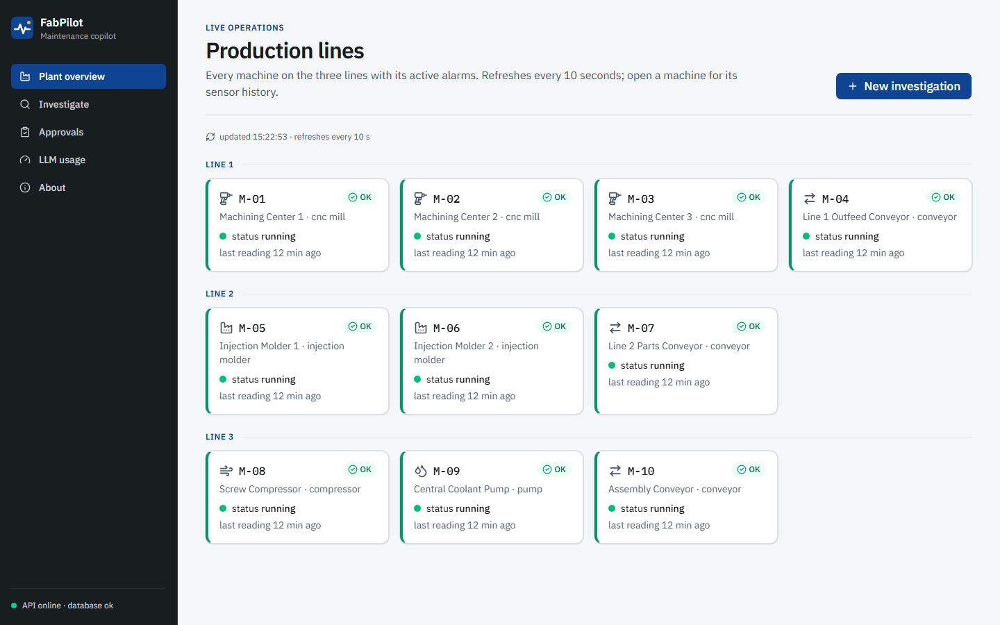

Ten machines on three production lines, each tile with its status, its newest reading and its
active alarms. The page refreshes every 10 seconds (TanStack Query polling `GET /plant/overview`).
The sidebar footer ("API online · database ok") is rendered **on the server** from `GET /health`,
the same endpoint Kubernetes uses as the API's readiness probe.

### 2. A fault appears

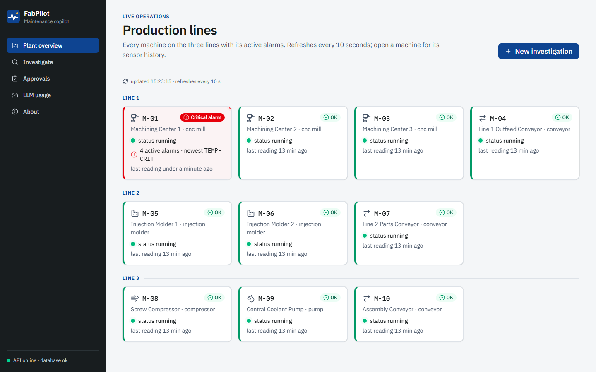

The simulator injects a known fault (`simulator inject --fault bearing_wear --machine M-01`): a
spindle bearing wearing out over three days. M-01 turns red with its active alarms. Known faults
are the point of the simulator: every one is a **ground truth** the eval suite can grade
the agent against.

### 3. The machine page: what the data says

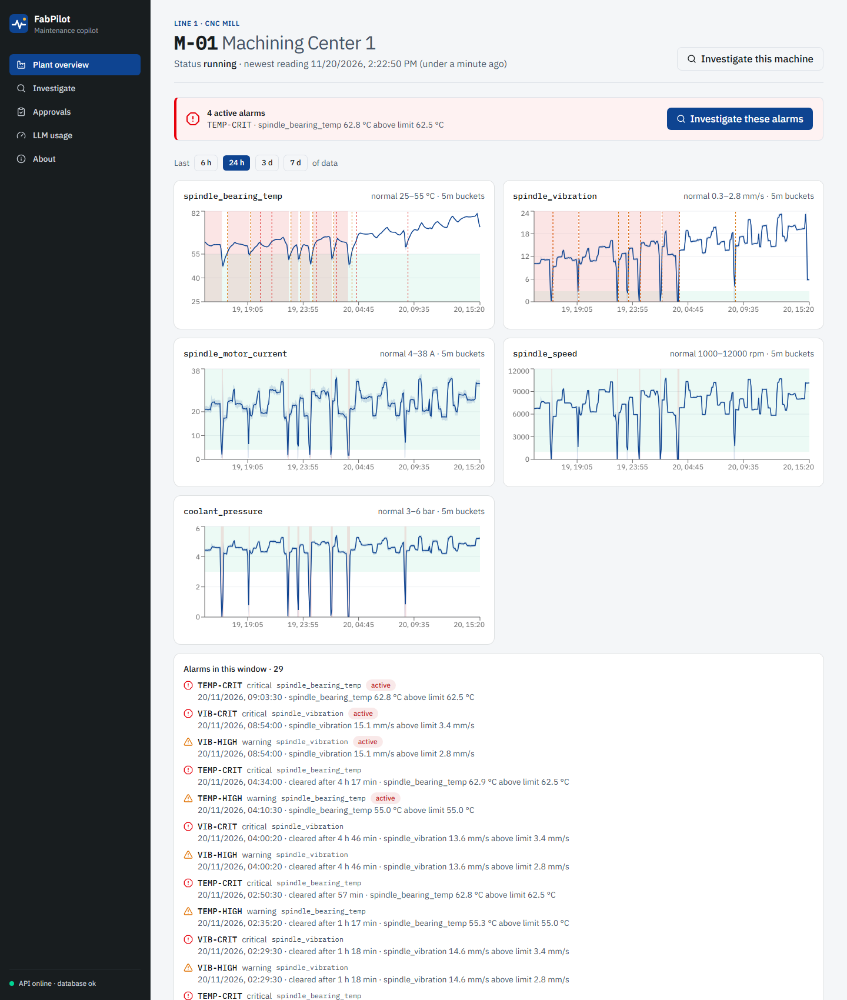

Every sensor of the machine with its **normal band** (green) and alarm periods (red), from
TimescaleDB with time-bucket aggregation (5-minute buckets for 24 h). Bearing wear has a
signature: **vibration rises first, temperature follows**; current, speed and coolant pressure
stay normal. Below, the alarm timeline with when each alarm fired and how long it lasted.
"Investigate these alarms" hands the active alarms to the next screen.

### 4. Asking the question

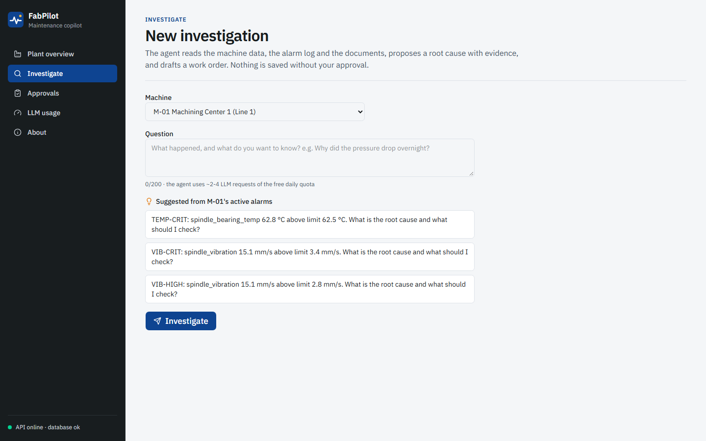

The engineer asks in plain language. The suggested questions are built from the machine's active
alarms, so the agent starts from the exact symptom. The form states the cost up front: an
investigation uses about 2-4 requests of the free daily quota.

### 5. The diagnosis

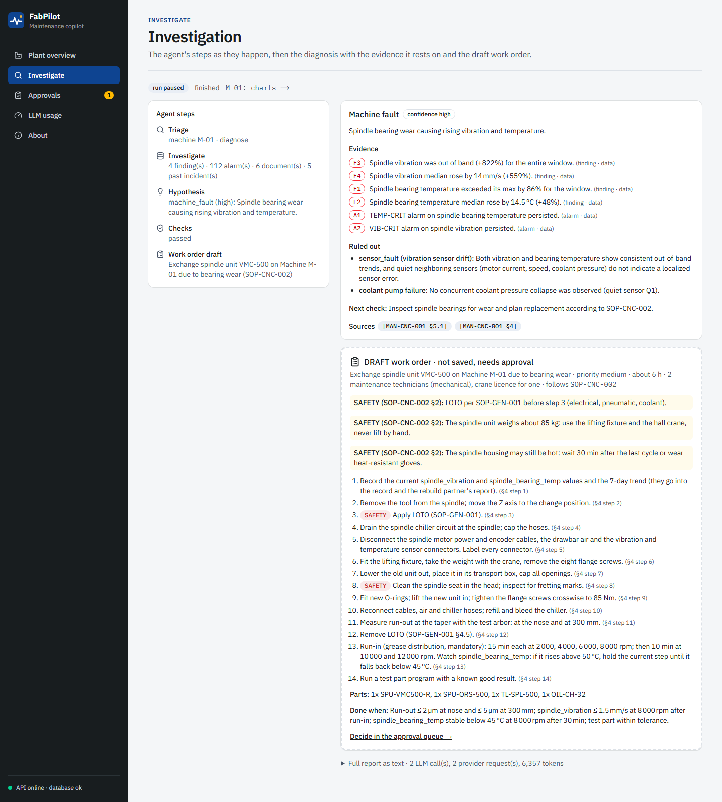

The core of FabPilot, a LangGraph agent whose steps stream to the browser over **Server-Sent
Events**:

- **Agent steps** (left): *triage* → *investigate* (calls the MCP tools: readings, alarms,
  anomaly detection, document search, past incidents) → *hypothesis* → *checks* → *work order
  draft*.
- **The diagnosis**: a fault category, a confidence, and the root cause in one sentence.
- **Evidence**: every claim points to a numbered item the tools returned, F = a finding from the
  anomaly detector, A = an alarm. The *checks* step enforces that rule: a diagnosis without
  current machine data behind it is rejected and asked again.
- **Ruled out**: the alternatives the agent considered, and why the data contradicts them
  (here: sensor drift, because temperature *and* vibration moved together).
- **Sources**: citations into the manuals (`[MAN-CNC-001 §5.1]`), retrieved by hybrid search
  (pgvector + Postgres full-text).
- **Draft work order**: the steps of the cited procedure (`SOP-CNC-002`), each with its section,
  safety steps flagged, parts, and a "done when" check. Marked **DRAFT, not saved**.
- The cost line at the bottom: 2 LLM calls, 6,357 tokens.

### 6. Human-in-the-loop: the approval queue

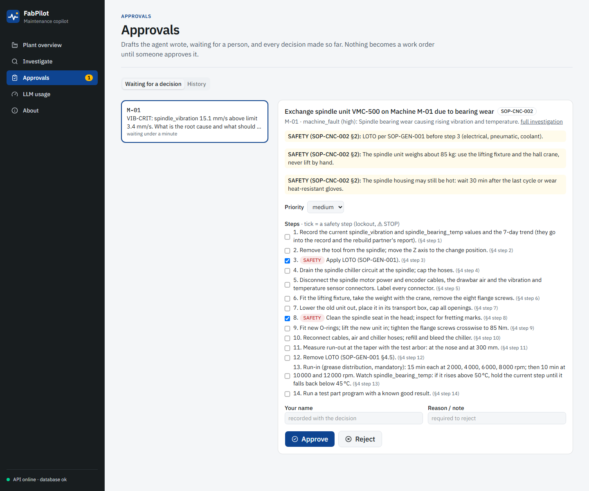

The agent run is **paused** here (a LangGraph `interrupt`, its state in a Postgres checkpointer,
so a restart of the API loses nothing). A person reads the draft, can change the priority and the
safety flags, and approves or rejects it; a rejection requires a reason. Nothing becomes a work
order before this decision.

### 7. The decision is recorded

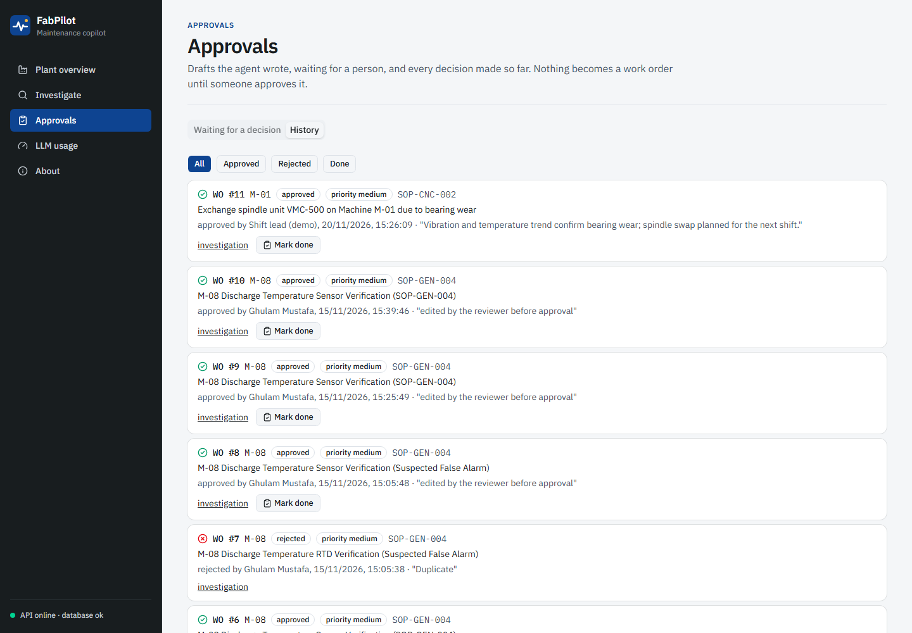

Every decision with who made it, when, and the note: the audit trail a plant needs. Approved work
orders can be marked done; the investigation behind each one stays one click away.

---

## Counter-case: a false alarm

The case that separates a diagnosis tool from an alarm forwarder. One temperature sensor on the
M-08 compressor **drifts**: it reports overheating while the machine is fine. The question is
deliberately leading: *"Is the compressor overheating, and should we stop it?"*

### 8. The data

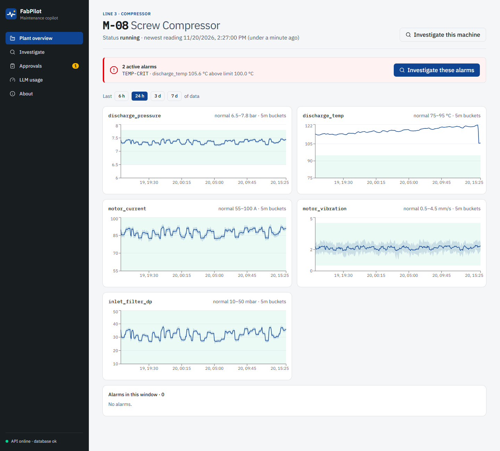

`discharge_temp` sits far above its band and raises a critical alarm. Its **physical neighbours**
do not move: a really overheating compressor would also show it in motor current, discharge
pressure or vibration. (The timeline is empty because the alarm started more than 24 h ago,
before the selected window; the banner counts it as still active.)

### 9. The agent clears the machine

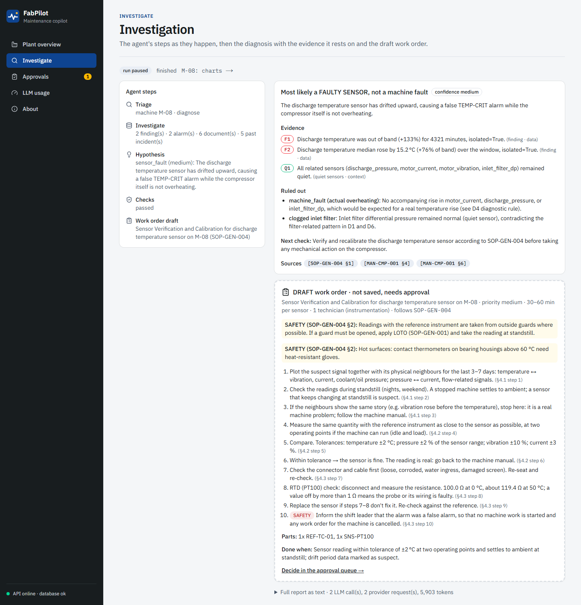

**"Most likely a FAULTY SENSOR, not a machine fault"**. The evidence is the one sensor out of band
*isolated* (F1, F2), and Q1: every related sensor stayed quiet. Ruled out: real overheating and a
clogged filter, each with the data that contradicts it. The draft work order is a sensor
verification and calibration (`SOP-GEN-004`), not a compressor repair, and its last step is to
tell the shift leader that the alarm was false, so no machine work is started.

Blaming the machine for a drifting sensor costs a stopped line and a needless repair. The eval
suite measures exactly this ("sensor drift blamed on the machine"), next to "fault invented on a
healthy machine".

---

## Operations

### LLM usage

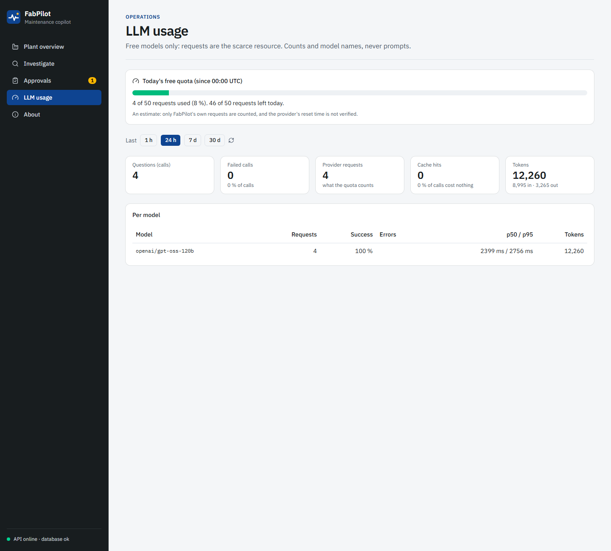

Free models make requests the scarce resource. Every gateway call is logged (model, tokens,
latency, status, cache hit), never the prompt. The page shows today's quota use, failure rate,
p50/p95 latency and tokens per model, the numbers you need to pick a model and to notice a
provider having a bad day.

### About

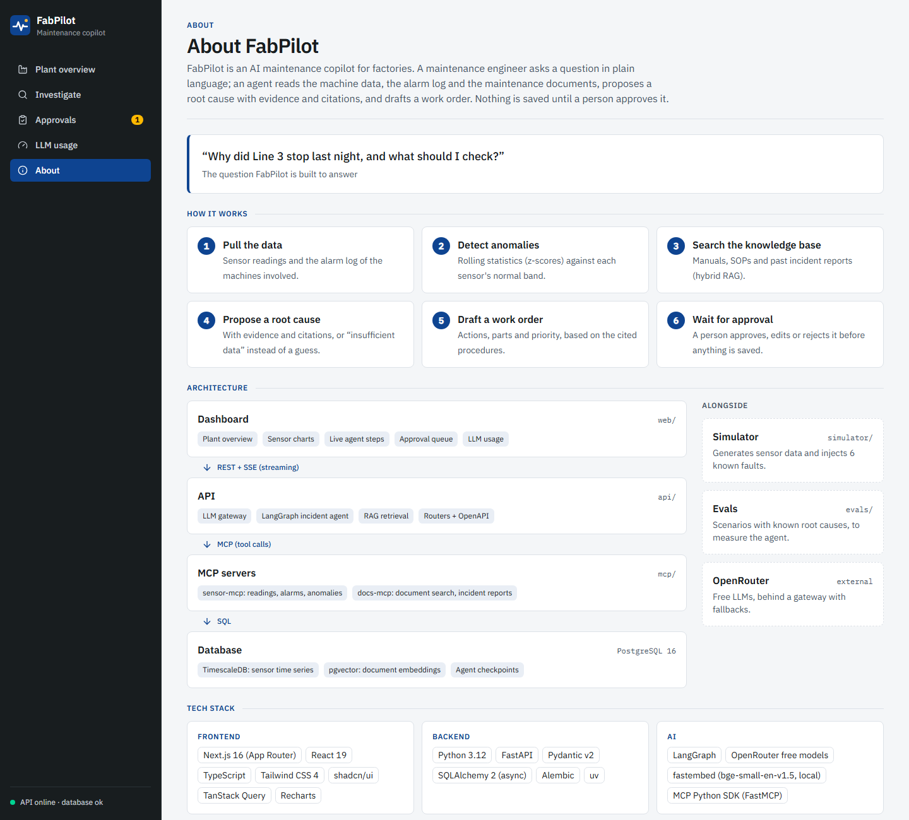

The product in six steps, the architecture (dashboard → API with gateway, agent and RAG → MCP
servers → PostgreSQL with TimescaleDB and pgvector) and the tech stack.

---

## Regenerating the screenshots

[`capture.ps1`](capture.ps1) drives headless Chrome over the Chrome DevTools Protocol from plain
PowerShell (no extra dependency): it navigates, waits real time (the investigation page streams
its steps over SSE, which Chrome's one-shot `--screenshot` mode doesn't wait for), optionally
clicks a tab, and saves the picture.

```powershell
# the dashboard as a production build (pnpm dev would show its "Compiling..." badge)
docker compose up -d                          # or the web image on another port
.\docs\ui\capture.ps1 -Name 01-overview-healthy -Path /
.\docs\ui\capture.ps1 -Name 05-run-diagnosis -Path /runs/<thread-id> -Height 1600 -WaitMs 10000
.\docs\ui\capture.ps1 -Name 07-approval-history -Path /approvals -Height 1000 -Click History
```
